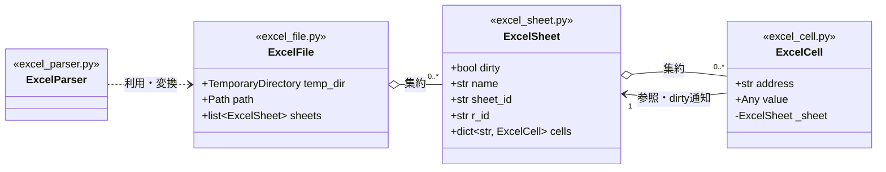

# xlsxpy
Excelの内部構造解析及びAPI

## 目的
スキルマップのエクセルシートなどを扱うにあたって、折り畳みや絞り込みが極めて複雑であることから、自分用にちょっとしたアプリケーションを作りたい。  
しかし、外部のライブラリ利用はソフトウェア利用申請が必要になるので、自分でAPIを実装すればよいのではないかというほんの好奇心。

## 解析に使う環境について
- Python 3を使う。  
- 追加のライブラリは使わず、*.xlsxそのものを解体して解析する。  

## 主要な標準ライブラリ
- xml.etree.ElementTree
    - *.xmlを解析する標準ライブラリ
    - 場合によっては、 `xml.dom.minidom` も検討

## 実装予定の機能
- エクセルファイルの読み込み
- 最終更新日などのメタデータ取得 (あれば)
- シートの取得
- セルの取得
- セルの変更

## 実装を予定しない機能
- 列や行の追加
    - これをするのは基本的にエクセルファイルで編集すべきと判断。
    - リレーションの複雑さや、列や行を入れるだけでそれより下や右の要素すべてへ更新が走るため、この点をどう綺麗に実装するかを検討する必要がある。

## 公式ドキュメント
- https://learn.microsoft.com/ja-jp/dotnet/api/documentformat.openxml.spreadsheet?view=openxml-3.0.1

## プロジェクト構造

※2026/11/13時点

## 責務
### ExcelCell
セルの要素や、番地などの情報を扱う。  
シートのインスタンスを保持しており、更新がされた場合にシートのdirtyフラグを立てる。

### ExcelFile
エクセルファイルは最終更新日や人などの情報が入っている場合があるため、その情報を扱う。  
このクラスでExcelSheetの集約を行っている。

### ExcelParser
\*.xlsx形式のファイルからxmlを抽出する規定処理と、抽出したxml群を圧縮して\*.xlsx形式へ戻す処理を担う。  
内部xmlの複雑な変換などの処理もここでまとめる。

### ExcelSheet
シートの名前やアクティブセル、リレーションなどの情報を扱う。  
このクラスでセルの集約を行っている。

## 備考
- リレーション周りがおそらく複雑なので、それらを処理するクラスを用意したほうがいいかもしれない。